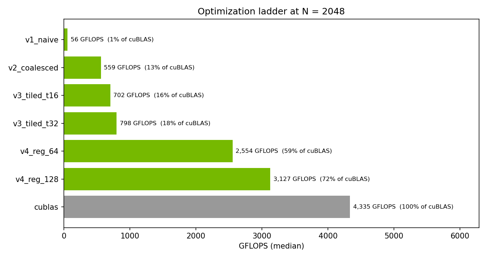
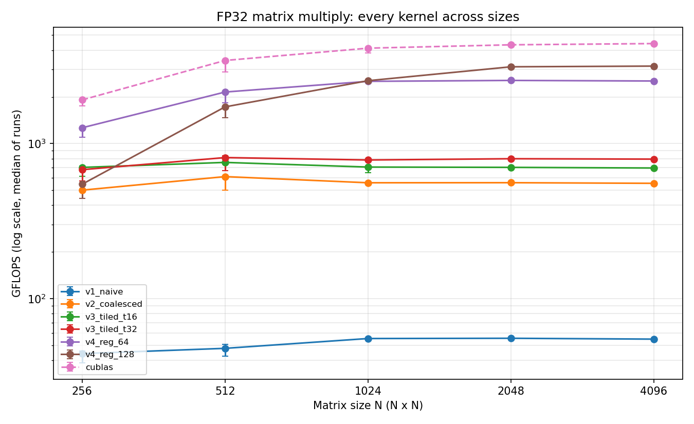
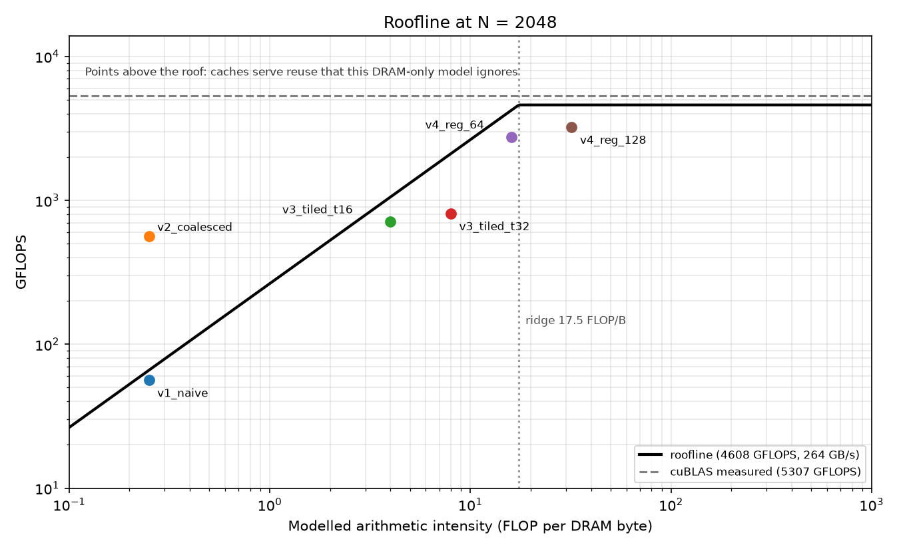

# CUDA Matrix Multiplication Optimization Ladder

Four hand-written CUDA SGEMM kernels, each fixing the bottleneck of the one before it, benchmarked against cuBLAS and explained with a roofline model and Nsight Compute counters. Plus a C++ cache simulator that reproduces the same locality ideas on the CPU.

**Headline (RTX 2060 Mobile, N = 2048, FP32):** the best kernel reaches **3,233 GFLOPS, 57x faster than the naive kernel and 61% of cuBLAS**.



## Results

Median of 3 runs, results verified against cuBLAS (relative tolerance 1e-3). GPU: GeForce RTX 2060 Mobile (Turing, sm_75, 30 SMs, 6 GB, 192-bit bus, 264 GB/s as reported by the driver).

**N = 2048**

| Kernel       | GFLOPS | % of cuBLAS | vs v1 | vs previous step |
| ------------ | -----: | ----------: | ----: | ---------------: |
| v1_naive     |     56 |        1.1% |  1.0x |                - |
| v2_coalesced |    562 |       10.6% | 10.0x |            9.99x |
| v3_tiled_t16 |    712 |       13.4% | 12.6x |            1.27x |
| v3_tiled_t32 |    811 |       15.3% | 14.4x |            1.44x |
| v4_reg_64    |  2,764 |       52.1% | 49.1x |            3.41x |
| v4_reg_128   |  3,233 |       60.9% | 57.4x |            3.99x |
| cublas       |  5,307 |      100.0% | 94.3x |            1.64x |

**N = 4096**

| Kernel       | GFLOPS | % of cuBLAS | vs v1 | vs previous step |
| ------------ | -----: | ----------: | ----: | ---------------: |
| v1_naive     |     55 |        1.3% |  1.0x |                - |
| v2_coalesced |    551 |       12.9% | 10.1x |           10.07x |
| v3_tiled_t16 |    695 |       16.3% | 12.7x |            1.26x |
| v3_tiled_t32 |    787 |       18.5% | 14.4x |            1.43x |
| v4_reg_64    |  2,468 |       57.9% | 45.1x |            3.14x |
| v4_reg_128   |  3,058 |       71.7% | 55.9x |            3.88x |
| cublas       |  4,265 |      100.0% | 78.0x |            1.39x |



> **Reading the sizes carefully.** From N = 2048 to 4096 my kernels lose 2-11% of their GFLOPS (v1 to v3: 2-3%, v4_reg_128: 5%, v4_reg_64: 11%), while cuBLAS loses 20% (5,307 to 4,265 GFLOPS). **I do not have a confirmed explanation for the cuBLAS drop.** A clock and power log taken during a short run showed no sign of thermal or power throttling (at most 41 W of the 80 W limit, at most 48 °C), but it covered only about four seconds of GPU activity, so it cannot rule out throttling in a longer run. N = 2048 is therefore the primary comparison. The run-to-run spread (min to max over the 3 runs) is at most 4% at N >= 2048 (median 1%), but it reaches 69% at N = 512, where each kernel runs for well under a millisecond and probably finishes before the GPU clock has ramped up. The headline results use N >= 2048, and the N <= 512 rows are the least reliable.

## The optimization story

| Step                    | Change                                                                  | Bottleneck it attacks               | Result at N = 2048      |
| ----------------------- | ----------------------------------------------------------------------- | ----------------------------------- | ----------------------- |
| v1 naive                | one thread per output element, `threadIdx.x` selects the row            | baseline                            | 56 GFLOPS               |
| v2 coalesced            | `threadIdx.x` selects the column so a warp reads neighbouring addresses | uncoalesced global loads and stores | **10.0x** over v1       |
| v3 shared-memory tiling | stage 16x16 or 32x32 tiles in shared memory, reuse them                 | repeated global-memory loads        | 1.44x over v2 (tile 32) |
| v4 register tiling      | each thread computes a 4x4 or 8x8 patch in registers                    | shared-memory loads per FMA         | **3.99x** over v3       |
| cuBLAS                  | vendor library                                                          | n/a                                 | the ceiling             |

### v1 to v2: coalescing (10x)

The only change is which thread index drives the row and which drives the column. In a warp, `threadIdx.x` varies fastest. In v1 neighbouring threads read A addresses N floats apart, so one warp-wide load of A splits into 32 separate 32-byte sector requests (the B load is a broadcast: 1 sector). In v2 a warp reads one broadcast value of A (1 sector) and a contiguous run of B (4 sectors).

Nsight Compute confirms this at N = 1024:

|              | Global-load requests |       Sectors | Sectors per request |
| ------------ | -------------------: | ------------: | ------------------: |
| v1_naive     |           67,108,864 | 1,107,296,256 |            **16.5** |
| v2_coalesced |           67,108,864 |   167,772,160 |             **2.5** |

Both values equal what the access pattern predicts (v1: (32 + 1) / 2, v2: (1 + 4) / 2), and v2 issues 6.6x fewer sector transactions for the same number of requests. The utilization counters (N = 2048) show that v1 is **not** DRAM-bound: DRAM is 1% busy, SM throughput is 6% of peak, and the memory pipeline is about 50% busy, so no unit is saturated. That is consistent with a kernel limited by the volume of tiny requests and their latency rather than by bandwidth.

### v2 to v3: shared-memory tiling (1.4x, less than the theory suggests)

v2 already gets heavy reuse from the L1/L2 caches. With no caching its loads would total 68.7 GB at N = 2048, but the profile (DRAM 11.5% busy for about 30 ms at 264 GB/s) implies only about 0.9 GB actually crossing the DRAM interface, roughly 74x less (an estimate from throughput percentages). v3 moved a similar amount (about 0.8 GB), so most of tiling's 1.4x gain does not come from less DRAM traffic. It presumably comes from replacing global-load requests through L1 with cheaper shared-memory accesses (not measured).

Tile 32 beat tile 16 by 11-14% at N >= 1024, plausibly because each value fetched from global memory serves more multiply-adds and there are fewer barriers per FLOP (not measured). At N = 256 tile 16 was faster (400 vs 362 GFLOPS) and I did not isolate why.

### v3 to v4: register tiling (4x)

After tiling, v3's busiest unit is the load/store pipe: every FMA needs two shared-memory loads. The profiler shows the shift:

|              | Load/store pipe busy | FMA (math) pipe busy |
| ------------ | -------------------: | -------------------: |
| v3_tiled_t32 |            **72.7%** |                13.7% |
| v4_reg_128   |                26.1% |            **60.5%** |

With an 8x8 patch per thread, 16 shared loads feed 64 FMAs (4 FMAs per load instead of 0.5). The bottleneck moved from data movement to arithmetic.

## Profiler evidence (Nsight Compute, N = 2048)

| Kernel       | Registers/thread | Theoretical / achieved occupancy | DRAM busy | Busiest SM-side unit | Shared-mem load bank conflicts |
| ------------ | ---------------: | -------------------------------: | --------: | -------------------: | -----------------------------: |
| v1_naive     |               49 |                     100% / 98.1% |      1.1% |                 6.0% |                              0 |
| v2_coalesced |               49 |                     100% / 99.6% |     11.5% |                80.5% |                              0 |
| v3_tiled_t32 |               42 |                    100% / 99.97% |     15.2% |                72.2% |                              0 |
| v4_reg_64    |               66 |                      75% / 73.5% |     27.8% |                48.7% |                              0 |
| v4_reg_128   |              123 |                  **50% / 47.7%** |     10.1% |                57.6% |                   37.7 million |

**The fastest kernel has the lowest occupancy.** v4_reg_128 uses 123 registers per thread, so only 2 blocks (16 warps) fit per SM. It runs fastest anyway because each thread keeps 64 accumulators in registers. Higher occupancy is not always better.

Absolute GFLOPS printed during profiling runs differ from the benchmark runs (Nsight Compute controls GPU clocks and replays kernels), so only utilization percentages and ratios are taken from profiling. The ratios were stable across profiling runs (for example v3 was 14.3% of cuBLAS in one run and 14.9% in another).

<details>
<summary>Profiling commands used (outputs in <code>results/profiles/</code>)</summary>

```bash
# utilization, occupancy, registers, bank conflicts (step6_metrics.txt)
ncu -k regex:matmul -c 1 --metrics $METRICS ./build/matmul 2048 1 --only v4_reg_128

# load/store vs FMA pipe (pipes_v3.txt, pipes_v4.txt)
ncu -k regex:matmul -c 1 \
  --metrics sm__pipe_fma_cycles_active.avg.pct_of_peak_sustained_active,sm__inst_executed_pipe_lsu.avg.pct_of_peak_sustained_active \
  ./build/matmul 2048 1 --only v4_reg_128

# coalescing: sectors per global-load request, N = 1024 (sectors_per_request.txt)
ncu -k regex:matmul -c 1 \
  --metrics l1tex__t_sectors_pipe_lsu_mem_global_op_ld.sum,l1tex__t_requests_pipe_lsu_mem_global_op_ld.sum \
  ./build/matmul 1024 1 --only v1_naive
```

</details>

## Roofline analysis



The chart draws the driver-reported peak, 4,608 GFLOPS FP32 (1,920 cores x 2 x 1.2 GHz), and 264 GB/s. The 4,608 GFLOPS line is a conservative "paper" peak: a clock log showed this GPU reaching 1,965 MHz under load (2 x 1,920 x 1.965 GHz = 7,546 GFLOPS theoretical), and cuBLAS measured up to 6.2 TFLOPS in some runs, above the drawn line. Read the chart as a model of where each kernel sits relative to the DRAM ridge, not as a precise ceiling. Modelled arithmetic intensity (FLOP per DRAM byte): naive and coalesced 0.25, tiled T/4, register-tiled 128x128 block 32.

The model counts DRAM traffic only, so kernels that benefit from L1/L2 reuse (v2, v3) land above their modelled roof. That is a limitation of the model, and the profiler data above is the better explanation for why they run as they do.

### 64 vs 128 register tiles

|    N | v4_reg_64 | v4_reg_128 |
| ---: | --------: | ---------: |
|  256 |   **654** |        269 |
|  512 | **1,319** |        931 |
| 1024 | **2,889** |      2,665 |
| 2048 |     2,764 |  **3,233** |
| 4096 |     2,468 |  **3,058** |

The 128 tile has higher data reuse but fewer, bigger blocks. Its 123 registers per thread allow only 2 resident blocks per SM (60 across 30 SMs), while the 64 tile fits 3 per SM (90 in total). At N = 1024 the 128 version launches 64 blocks, so 4 blocks spill into a second wave, while the 64 version runs 256 blocks in about 3 waves with little waste. A simple wave model would predict about 2,000 GFLOPS for the 128 version at N = 1024, but it measured 2,665, so the effect is real but smaller than the model suggests (blocks do not run in lockstep). I treat the tail effect as a contributing factor rather than a proven cause. The crossover lies between N = 1024 and 2048.

## CPU cache experiments

The GPU ideas (coalescing, tiling) are locality ideas. I reproduced them on the CPU.

**Measured on `Intel(R) Core(TM) i7-10750H CPU @ 2.60GHz`:**

- Walking a 4096x4096 int matrix column by column was **6.9x slower** than row by row (27.7 ms vs 4.0 ms).
- Visiting every element at stride 1 costs 0.40 ns per element. At stride 16 ints (one 64-byte line) it costs 2.81 ns, and from stride 64 on it plateaus at 5.3-6.3 ns, which is 13-16x the stride-1 cost. Only 1 of 16 ints in each fetched line is useful, so the cost approaches 16x.

**LRU cache simulator** (32 KB, 64-byte lines, 512x512 ints):

| Access pattern                          |  Hit rate |
| --------------------------------------- | --------: |
| row by row                              |    93.75% |
| column by column (8-way)                | **0.00%** |
| column by column, 8x8 blocks            |    93.75% |
| column by column, **fully associative** |    93.75% |

A column step is 2048 bytes = 32 cache lines, so all addresses fall into 2 of the 64 sets. Those sets hold 16 lines, a column pass touches 512, and every line is evicted before reuse. The fully associative result shows these are **conflict** misses, not capacity misses. Blocking restores locality, which is the same idea as shared-memory tiling.

## Methodology and caveats

- Timing uses CUDA events, one warm-up run, then the average over several repetitions. Every benchmark session reports the median of 3 independent runs with a cooldown between them.
- Every kernel is checked against cuBLAS output on the same random inputs (relative tolerance 1e-3, with an absolute floor of 1). cuBLAS itself was verified against a CPU reference at N <= 512. `compute-sanitizer` reports 0 errors (run at N = 256 with 1 repetition, all kernels).
- Laptop GPU: in a clock log the GPU went from 300 MHz at idle to 1,965 MHz within about four seconds of load. Absolute numbers shift by 10-20% between benchmark sessions (cuBLAS at N = 2048 ranged from 5,307 to 6,228 GFLOPS across my runs) and more under the profiler, so ratios are more reliable than absolute values.
- v4 assumes N is a multiple of 128. Turing has no TF32, so cuBLAS ran true FP32.
- **Bank conflicts in v4_reg_128 (not yet confirmed).** v4_reg_64 (4-float patches per thread) shows 0 shared-load bank conflicts, while v4_reg_128 (8-float patches) shows 37.7 million. With 8 consecutive floats per thread, neighbouring threads' 16-byte shared loads of the B tile sit 32 bytes apart, so 8 threads span 256 bytes and wrap around the 128-byte width of the 32 banks, which would cause 2-way conflicts. With 4 floats they sit 16 bytes apart and fit exactly. The A-tile read pattern is structurally the same in both kernels, which points to the B tile. I have not confirmed this in Nsight's source view and cannot yet account for the exact count.

## What is missing compared with cuBLAS

The remaining gap at N = 2048 is 1.64x. Known next steps: `float4` vectorized global loads, removing the shared-memory bank conflicts (hypothesis: interleave each thread's 8 columns as two 4-wide groups 64 apart; untested), double buffering (load the next tile while computing the current one), warp-level tiling, and Tensor Core kernels for FP16.

## Build and run

```bash
make                                   # builds everything (needs CUDA Toolkit, sm_75 by default)
make ARCH=sm_86 matmul                 # other GPUs: set the architecture
./build/matmul 2048                    # readable table; also: N reps --csv --only KERNEL
python3 scripts/run_bench.py           # repeat-and-median benchmark -> results/summary.csv
python3 scripts/plot.py                # charts
python3 cache_sim/run_sim.py           # cache simulator experiments
```

Python dependencies: `pip install -r requirements.txt`. Measured on Ubuntu with CUDA toolkit 13.4 (nvcc) and driver 595.99.02.

## Repository layout

```
src/            harness (main.cu), helpers (common.cuh), kernels/ v1 to v4
scripts/        run_bench.py, plot.py, make_table.py
cache_sim/      C++ LRU cache simulator, trace generator, runner
experiments/    CPU cache-effect experiment
warmup/         first kernels and a device-info tool
results/        CSVs, charts, profiler metric dumps, clock log
```

## References

- Simon Boehm, "How to Optimize a CUDA Matmul Kernel for cuBLAS-like Performance: a Worklog"
- Kirk and Hwu, _Programming Massively Parallel Processors_
- Williams, Waterman, Patterson, "Roofline: An Insightful Visual Performance Model" (CACM 2009)
